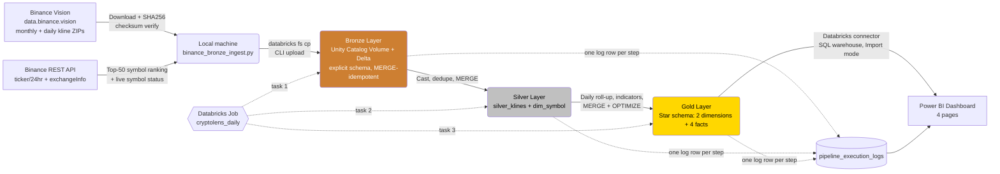

# CryptoLens 🕯️📊
### A Medallion Architecture Lakehouse for Crypto Market Data (Binance Vision Klines)

[](https://spark.apache.org/)
[](https://delta.io/)
[]()
[]()

> An end-to-end, automated data pipeline that ingests real historical and daily OHLCV (Open, High, Low, Close, Volume) candlestick data for the top 50 Binance USDT trading pairs, processes it through **Bronze → Silver → Gold** layers on Apache Spark / Delta Lake, and serves a Power BI dashboard for market analysts.

---

## 📌 Project Overview

| | |
|---|---|
| **Domain** | Financial Markets / Cryptocurrency Trading Analytics |
| **Data Source** | [Binance Vision](https://data.binance.vision) (historical klines) + [Binance REST API](https://binance-docs.github.io/apidocs/spot/en/) (`/ticker/24hr`, `/exchangeInfo`) |
| **Dataset** | Spot Klines (1-minute candles) for the **top 50 USDT pairs** by 24h quote volume, selected dynamically — not a hardcoded symbol list |
| **Platform** | Databricks Free Edition (Serverless SQL/Compute) — Apache Spark + Delta Lake + Unity Catalog Volumes |
| **BI Tool** | Power BI |
| **Team** | Abdullah Saeed & Arqum Umais |
| **Course** | Data Analysis and Visualization — Semester Project |

CryptoLens tracks price action and trading activity across the 50 most actively traded Binance USDT spot pairs so analysts can study volatility, trend, and cross-asset correlation — the kind of daily-cadence analysis a trading desk or research team relies on.

---

## 🏗️ Architecture



**Ingestion pattern:**
- **Full Load** — one monthly 1-minute kline file per tracked symbol (~43,200 rows/symbol/month) across all 50 tracked pairs (~200 MB total).
- **Incremental Load** — one daily 1-minute kline file per tracked symbol (~1,440 rows/symbol/day), refreshed on every pipeline run (~10 MB/day total).
- **Checksum verification** — every downloaded ZIP is SHA256-hashed and compared against Binance's own `.CHECKSUM` sidecar file before being trusted and extracted.
- **Network workaround** — confirmed via direct DNS resolution testing that Databricks Free Edition's serverless compute cannot resolve `api.binance.com` or `data.binance.vision` (while `pypi.org`/`github.com` resolve fine) — an environment-specific domain allowlist, not a full internet block. Downloading therefore runs on a local machine (`binance_bronze_ingest.py`), and verified files are pushed into the Bronze Unity Catalog Volume via the Databricks CLI (`databricks fs cp`).
- **`dim_symbol`** — Binance's `/exchangeInfo` endpoint is snapshotted and merged into `dim_symbol` in Silver, since trading-pair status, listings, and delistings genuinely change over time. This gives the pipeline a real `MERGE` (insert + update + soft-delete), instead of the append-only kline data alone.

---

## 📂 Repository Structure

```
cryptolens/
├── docs/                                       # Proposals, data dictionary, phase deliverables
│   ├── Phase1_Project_Proposal_Crypto_Pipeline.docx
│   ├── Phase2_CryptoLens.pdf
│   ├── CryptoLens_Data_Dictionary.pdf          # Bronze + Silver
│   └── gold_data_dictionary.md                 # Gold: ER diagram, keys, grain, load strategy
├── notebooks/                                  # One notebook per pipeline stage
│   ├── 00_layers_verification.ipynb            # Validation: counts, idempotency, audit-log checks
│   ├── 01.1_bronze_ingest_data extractor.ipynb # Local-machine download + SHA256 verification
│   ├── 01.2_bronze_ingest.ipynb                # Databricks: Raw -> Bronze
│   ├── 02_silver_transform.ipynb               # Databricks: Bronze -> Silver
│   └── 03_gold_transform.ipynb                 # Databricks: Silver -> Gold (star schema)
├── dashboards/
│   └── CryptoLens_Dashboard.pbix               # Power BI report (4 pages)
├── .gitignore                                  # excludes bulk full_load/ and incremental_load/ data
└── README.md
```

**Notebook roles:**
- `01.1_bronze_ingest_data extractor` runs **locally** (not in Databricks): downloads monthly/daily kline ZIPs, verifies each SHA256 checksum, and extracts CSVs ready for upload to the Volume.
- `01.2_bronze_ingest` and `02_silver_transform` run in Databricks Serverless and implement the Raw → Bronze and Bronze → Silver stages.
- `03_gold_transform` runs in Databricks Serverless as the **last task** of the `cryptolens_daily` Job: it rolls the 1-minute Silver candles up to daily facts, derives volatility / moving-average / correlation tables, optimises them, and logs every step.
- `00_layers_verification` is a read-only validation notebook: table existence, per-layer row/symbol counts, idempotency re-run check, audit-log review, quarantine and quality-filter counts.

**Still to add before final submission:**
- `samples/` — one real, checksum-verified symbol (`BTCUSDT`, monthly + daily) with a schema README
- `docs/` — the final Phase 3 architecture & FinOps report (PDF)

The bulk 50-symbol working dataset (`full_load/`, `incremental_load/`) is intentionally **not** committed to git — it's excluded via `.gitignore` and instead lives in the Databricks Unity Catalog Volume (`workspace.cryptolens.bronze_raw`), keeping the repository lean while the real analytical dataset still meets the required size thresholds.

---

## 🗃️ Data Model

Full column-level definitions, types, and keys are in **[`docs/CryptoLens_Data_Dictionary.pdf`](docs/CryptoLens_Data_Dictionary.pdf)**. Summary:

### Bronze (`01.2_bronze_ingest.ipynb`)
- **`bronze_klines`** — raw kline rows, explicit schema (`StructType`, no `inferSchema`), tagged with `symbol`, `interval`, `load_type`, `source_file`, `load_timestamp`. Idempotent `MERGE` on `(symbol, interval, load_type, open_time)`.
- **`bronze_exchange_info`** — raw `/exchangeInfo` JSON snapshots, one per run, feeding `dim_symbol`.
- **`bronze_quarantine`** — rows that fail schema-on-read (PERMISSIVE mode + `_corrupt_record`) are routed here instead of crashing the batch.

### Silver (`02_silver_transform.ipynb`)
- **`silver_klines`** — one row per `(symbol, interval, open_time)`. Casts epoch-ms longs to `TIMESTAMP`, price columns (`open`/`high`/`low`/`close`) to `DECIMAL(18,8)`, and volume columns (`volume`, `quote_asset_volume`, `taker_buy_*_vol`) to the wider `DECIMAL(28,8)` — high-supply symbols can trade volumes that overflow `DECIMAL(18,8)`. Idempotent `MERGE` (`WHEN MATCHED THEN UPDATE` / `WHEN NOT MATCHED THEN INSERT`) handles both re-runs and a full-load file later correcting an incremental-load value. Quality rules drop rows where `high < low` or `close`/`open` fall outside `[low, high]`.
- **`dim_symbol`** — maintained with a real three-branch `MERGE`: `UPDATE` on status/filter change, `INSERT` for new listings, soft-delete (`is_active = false`) for delistings — history is preserved, never hard-deleted.

### Audit (both layers)
- **`pipeline_execution_logs`** — one row per file/batch processed at every layer, every run: `layer`, `parameter_processed`, `load_type`, `start_time`/`end_time`, `status` (`SUCCESS`/`FAILURE`/`SKIPPED`), `rows_inserted`, `rows_updated`, `error_message`.

### Gold (`03_gold_transform.ipynb`) — star schema in `workspace.gold`

Full column definitions and the ER diagram are in **[`docs/gold_data_dictionary.md`](docs/gold_data_dictionary.md)**.

| Table | Type | Grain | Key | Load strategy |
|---|---|---|---|---|
| `dim_symbol` | Dimension | one USDT trading pair (all pairs in the `exchangeInfo` snapshot) | `symbol_key` | `MERGE`: status changes recorded (`previous_status`, `status_changed_date`); pairs missing from the latest snapshot marked `DELISTED` |
| `dim_date` | Dimension | one calendar day | `date_key` (`yyyyMMdd`) | Overwrite (tiny, regenerated from the fact date range) |
| `fact_daily_ohlcv` | Fact | symbol × day, rolled up from 1-minute Silver | `(symbol_key, date_key)` | `MERGE`, incremental (reprocesses the latest 2 days) |
| `volatility_daily` | Derived fact | symbol × day | `(symbol_key, date_key)` | Overwrite from the fact table: daily / log returns, intraday range, 7-day rolling volatility (annualised) |
| `moving_averages` | Derived fact | symbol × day | `(symbol_key, date_key)` | Overwrite: short / long SMA, `BULLISH` / `BEARISH` trend, `GOLDEN_CROSS` / `DEATH_CROSS` flags |
| `symbol_correlation` | Derived fact | symbol pair × day | `(symbol_a_key, symbol_b_key, date_key)` | Overwrite: rolling 14-day correlation of daily log returns, top 15 symbols by quote volume |

- **Keys:** `symbol_key = abs(xxhash64(symbol))`, identical in every table, so Power BI joins on a single integer column. `date_key` is an `int` in `yyyyMMdd` form.
- **Relationships:** every fact table is many-to-one to `dim_symbol` and `dim_date` (eight active relationships in the Power BI model).
- **Read optimisation:** `OPTIMIZE … ZORDER BY (symbol_key, date_key)` runs after every load on the four fact tables (`symbol_a_key, date_key` for the correlation table).
- **Audit:** every Gold step writes to `pipeline_execution_logs` with `layer = 'Silver-to-Gold'`, including start/end time, source rows read, and rows inserted / updated (taken from Delta commit metrics for `MERGE` steps).

---

## ⚙️ Engineering Practices (Phase 2)

- **Strict schema-on-read** — every CSV/JSON read uses an explicit `StructType`; `inferSchema` is never used.
- **Idempotency** — every write path uses Delta `MERGE INTO`; re-running either notebook with identical parameters produces zero duplicate rows (verified by re-running twice and comparing row counts).
- **Parameterized backfills** — Bronze exposes `interval`/`load_type`/`year`/`month`/`day` as Databricks widgets and Silver exposes `interval`/`load_type`; no function hardcodes "today," so any historical batch can be reprocessed on demand. Symbols are auto-discovered (from files in the Volume for Bronze, from `bronze_klines` for Silver) rather than typed in, so there is no manual list to drift out of sync.
- **Schema drift handling** — PERMISSIVE CSV mode routes unparseable rows to `bronze_quarantine` rather than failing the batch; Delta writes use `mergeSchema=true` to tolerate newly-added columns.
- **Serverless-compatible code** — no RDD APIs (including `DataFrame.isEmpty()`, which wraps `.rdd` internally); emptiness checks use `limit(1).count()`.
- **Audit logging** — every file/batch processed, across both Full and Incremental loads and both layers, writes a row to `pipeline_execution_logs`.

**Phase 3 additions**
- **Pipeline integration** — a Databricks Job, `cryptolens_daily`, runs `01.2_bronze_ingest` → `02_silver_transform` → `03_gold_transform` as three dependent serverless tasks, so Gold refreshes automatically after Silver (a repeat run leaves every Gold row count unchanged: idempotent `MERGE`).
- **Safe arithmetic** — ratios in Gold (`vwap`, returns, range %) use `try_divide`, because zero-volume days otherwise raise `DIVIDE_BY_ZERO` under ANSI mode.
- **Timestamp-unit drift handled in Gold** — see *Known limitations*.
- **Parameterised Job** — Job parameters map to the existing widgets (`load_type`, `interval`, `year`, `month`, `day`), so no notebook is edited by hand to run a different batch.

Full writeup: **[`docs/Phase2_CryptoLens.pdf`](docs/Phase2_CryptoLens.pdf)** (includes a log of issues hit on Serverless and how each was resolved).

---

## ⚠️ Known Limitations

- **Timestamp unit drift (found in Phase 3).** The raw schema assumes `open_time` / `close_time` are epoch **milliseconds**, but Binance's 2026 files use **microseconds**. The values still parse as `LongType`, so nothing is quarantined, but Silver's `/ 1000` conversion yields dates around the year 58,000. Gold corrects this when it reads Silver (divides by 1000 again for any timestamp beyond year 2200); the proper fix is to detect the unit in Silver by the raw value's magnitude. Until then, **query Gold, not `silver_klines`, for dates**.
- **Gap between loads.** The data covers 1–31 August 2026 plus 25 September 2026, so Gold's row-based windows treat 25 September as the day after 31 August. Moving averages and correlations on that date are computed across the gap.
- **Short history.** Moving-average windows are 5 / 20 days (not 50 / 200) and the correlation window is 14 days, because only about a month is loaded. They are configurable in the notebook's config cell.
- **One `exchangeInfo` snapshot.** `dim_symbol` status-change tracking is built, but with a single snapshot every `status_changed_date` equals the snapshot date.
- **Per-symbol loop.** Bronze and Silver process one symbol at a time (see FinOps).

---

## 🔐 Security & Compliance

**No PII is present in this dataset.** Every field — OHLC, volume, trade count, and symbol status — is an aggregated, anonymous market statistic with no usernames, account IDs, wallet addresses, or IP addresses. Binance publishes both the historical klines and `exchangeInfo` as fully public, aggregated market data. Standard data-quality and governance controls (schema enforcement, immutable Bronze audit trail, workspace-level access control) are applied through the Medallion layers.

---

## 📊 Dashboard (Power BI)

The report (`dashboards/CryptoLens_Dashboard.pbix`) connects to the `workspace.gold` schema (plus `pipeline_execution_logs`) through the Power BI **Databricks connector** and a Serverless SQL warehouse, in **Import** mode. The model mirrors the star schema: every fact table is many-to-one to `dim_symbol` and `dim_date`; the audit table stands alone.

| Page | Visuals | Business question answered |
|---|---|---|
| **Price & Volatility** | Coin slicer; close-price line; annualised-volatility line; KPI cards (total trades, USDT volume) | How have price and volatility trended per asset? |
| **Signals & Status** | Price with short / long moving averages; golden / death crosses per day; current bullish vs bearish split (all symbols); Binance USDT pairs by trading status | Which assets are bullish or bearish? Which pairs have which trading status? |
| **Correlation** | Rolling-correlation heatmap (top 15 symbols by volume, colour scale −1 to 1); average correlation over time | How correlated are the assets, and is it rising or falling? |
| **Pipeline Audit** | Log-entry and failure counts; rows inserted / updated by layer; average step duration by layer; activity over time; error log | Is the pipeline healthy, and what did each layer do? |

**Reading the charts:** the loaded data covers August 2026 (full load) plus 25 September 2026 (incremental load), so trend lines are drawn only over August, and values on 25 September follow a gap in the data (see *Known limitations*).

---

## 💰 FinOps & Cost Awareness

- **Platform:** Databricks Free Edition — serverless compute, no idle cluster cost.
- **Download cost:** the heavy top-50 symbol download runs locally (not on billed Databricks compute); only the already-verified CSVs are uploaded into the Unity Catalog Volume.
- Scope is fixed at the top 50 USDT pairs × 1-minute interval for the semester, sized to comfortably clear reviewer-set thresholds (~200 MB full load, ≥1 MB daily incremental) without ballooning further.
- `OPTIMIZE` / `Z-ORDER` used sparingly, only on Gold tables (Phase 3).
- Incremental job scheduled once daily (`cryptolens_daily`, 02:00 UTC trigger configured), matching Binance's own publication cadence — no unnecessary cluster spin-ups.
- **Measured run time** (one daily incremental batch, 50 symbols × 1 day, serverless, Free Edition): Bronze ≈ 5 min 52 s, Silver ≈ 7 min 40 s, Gold ≈ 1 min 8 s — **≈ 14 min 41 s end to end**. Bronze and Silver dominate because they loop over symbols with one `MERGE` per symbol; Gold works on whole tables.
- **Main optimisation identified:** batch all symbols into a single read and one `MERGE` per layer, which would cut the bulk of the run time (and compute cost on a paid platform) roughly in proportion. Derived Gold tables currently rebuild from the fact table each run, which is fine at this scale but would need to become incremental for an hourly enterprise run.
- Free Edition has no per-run billing, so cost projections (daily vs hourly, per year) are estimates, set out in the final report.
- Fallback: Azure for Students credits if more headroom is needed for Phase 3 dashboard testing.

---

## 🗓️ Roadmap

- [x] **Phase 1** — Proposal, real checksum-verified sample data, architecture design, network-workaround documented *(26 Sep 2026)*
- [x] **Phase 2** — Bronze & Silver notebooks implemented: explicit schemas, idempotent MERGE, parameterized backfills, schema-drift quarantine, audit logging *(completed; verified via `00_layers_verification.ipynb`)*
- [x] **Phase 3** — Gold star schema, Job-based automation, Power BI dashboard, final report *(due 24 Oct 2026)*

---

## 👥 Team

| Name | Role |
|---|---|
| Abdullah Saeed (24L-2529) | Pipeline Engineering (Bronze layer) |
| Arqum Umais (24L-2591) | Data Modeling & BI (Silver layer, dashboarding) |

---

## 📄 License

This project is for academic purposes as part of a "Data Analysis and Visualization" semester course. Source data © [Binance](https://www.binance.com/), published via [Binance Vision](https://data.binance.vision) for public research and analytical use.
