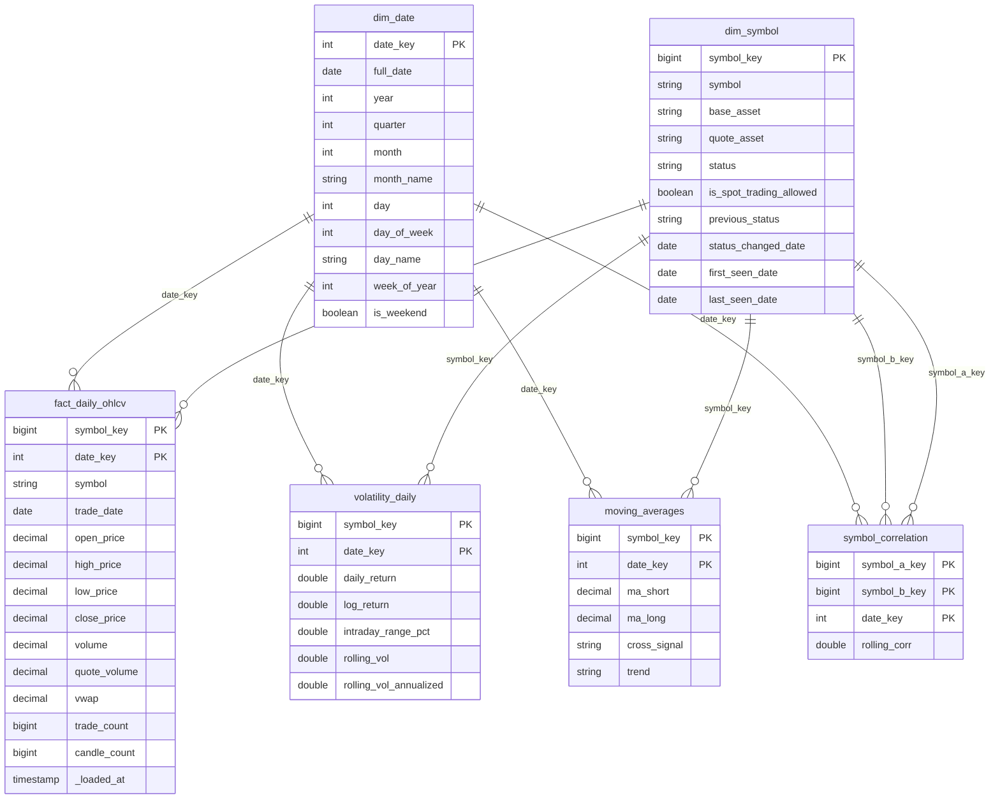

# Gold Layer Data Dictionary

Schema: `workspace.gold`. Source: `workspace.cryptolens.silver_klines` (1-minute candles) and the Binance `exchangeInfo` snapshot.
Built by `notebooks/03_gold_transform`. Model type: **star schema** with two dimensions and four fact-style tables sharing the same keys.

## 1. Entity-Relationship Diagram

Relationships are all **one-to-many**: one dimension row to many fact rows. Every fact table carries `symbol_key` and `date_key`, so Power BI can filter all of them from one symbol slicer and one date slicer.

## 2. Grain and load strategy

| Table | Type | Grain (1 row =) | Primary key | Load strategy |
|---|---|---|---|---|
| `dim_symbol` | Dimension | one USDT trading pair | `symbol_key` | MERGE: updates status, tracks changes, marks missing pairs `DELISTED` |
| `dim_date` | Dimension | one calendar day | `date_key` | Overwrite (tiny, regenerated from fact date range) |
| `fact_daily_ohlcv` | Fact | symbol x day | `(symbol_key, date_key)` | MERGE, incremental (reprocesses last 2 days) |
| `volatility_daily` | Fact | symbol x day | `(symbol_key, date_key)` | Overwrite, rebuilt from fact |
| `moving_averages` | Fact | symbol x day | `(symbol_key, date_key)` | Overwrite, rebuilt from fact |
| `symbol_correlation` | Fact | symbol pair x day | `(symbol_a_key, symbol_b_key, date_key)` | Overwrite, rebuilt from fact |

## 3. Table dictionaries

### dim_symbol
| Column | Type | Description |
|---|---|---|
| `symbol_key` | bigint | Surrogate key: `abs(xxhash64(symbol))`. Same formula is used in every fact table. |
| `symbol` | string | Binance pair name, e.g. `BTCUSDT` |
| `base_asset` / `quote_asset` | string | e.g. `BTC` / `USDT` |
| `status` | string | Current Binance status (`TRADING`, `BREAK`, `HALT`, ... or `DELISTED` if absent from the latest snapshot) |
| `is_spot_trading_allowed` | boolean | From exchangeInfo |
| `previous_status` | string | Status before the last change (NULL if never changed) |
| `status_changed_date` | date | Snapshot date of the last status change (answers business question 4) |
| `first_seen_date` / `last_seen_date` | date | First and latest snapshot date where the pair appeared |

### dim_date
| Column | Type | Description |
|---|---|---|
| `date_key` | int | `yyyyMMdd`, e.g. `20260925` |
| `full_date` | date | Calendar date |
| `year`, `quarter`, `month`, `day` | int | Date parts |
| `month_name`, `day_name` | string | e.g. `September`, `Friday` |
| `day_of_week` | int | 1 = Sunday ... 7 = Saturday |
| `week_of_year` | int | |
| `is_weekend` | boolean | |

### fact_daily_ohlcv
| Column | Type | Description |
|---|---|---|
| `symbol_key` | bigint | FK to `dim_symbol` |
| `date_key` | int | FK to `dim_date` |
| `symbol`, `trade_date` | string, date | Natural keys, kept for readability |
| `open_price` | decimal | Open of the first 1-minute candle of the day (`min_by(open, open_time)`) |
| `high_price` / `low_price` | decimal | Max high / min low over the day |
| `close_price` | decimal | Close of the last candle of the day (`max_by(close, open_time)`) |
| `volume` | decimal | Base-asset volume, sum of candles |
| `quote_volume` | decimal | USDT volume, sum of candles |
| `vwap` | decimal | `quote_volume / volume`; NULL when volume is 0 |
| `trade_count` | bigint | Sum of `number_of_trades` |
| `candle_count` | bigint | 1-minute candles in the day (1,440 = complete day) |
| `_loaded_at` | timestamp | When the row was last written |

### volatility_daily
| Column | Type | Description |
|---|---|---|
| `symbol_key`, `date_key` | | Keys |
| `daily_return` | double | `close / previous close - 1` |
| `log_return` | double | `ln(close / previous close)` |
| `intraday_range_pct` | double | `(high - low) / open` |
| `rolling_vol` | double | Std. deviation of log returns over `VOL_WINDOW` (7) days |
| `rolling_vol_annualized` | double | `rolling_vol * sqrt(365)` |

### moving_averages
| Column | Type | Description |
|---|---|---|
| `symbol_key`, `date_key` | | Keys |
| `ma_short` / `ma_long` | decimal | Simple moving average of close over `MA_SHORT` (5) / `MA_LONG` (20) days; NULL until the window is full |
| `cross_signal` | string | `GOLDEN_CROSS` (short crosses above long), `DEATH_CROSS` (below), else NULL |
| `trend` | string | `BULLISH` if short > long, `BEARISH` if short < long |
| `ma_short_window` / `ma_long_window` | int | Window sizes used for the row |

### symbol_correlation
| Column | Type | Description |
|---|---|---|
| `symbol_a_key`, `symbol_b_key`, `date_key` | | Keys. One row per pair (A < B alphabetically), so the heatmap must mirror it |
| `symbol_a`, `symbol_b`, `trade_date` | | Readable columns |
| `rolling_corr` | double | Pearson correlation of daily log returns over `CORR_WINDOW` (14) days. Only the top 15 symbols by quote volume are included, and only rows with a full window |

## 4. Audit table (shared with Bronze and Silver)
`workspace.cryptolens.pipeline_execution_logs`. Gold writes one row per step with `layer = 'Silver-to-Gold'`.

| Column | Gold usage |
|---|---|
| `run_id` | One UUID per log row |
| `layer` | `Silver-to-Gold` |
| `parameter_processed` | `<table> [MERGE/OVERWRITE/OPTIMIZE] source_rows=<n>` |
| `load_type` | `full` or `incremental` |
| `start_time` / `end_time` | Step start and end (execution time = difference) |
| `status` | `SUCCESS` or `FAILURE` |
| `rows_inserted` / `rows_updated` | From Delta commit metrics for MERGE; rows written for overwrites |
| `error_message` | Error text when failed |

## 5. Business questions to tables

| Question | Tables |
|---|---|
| Price and volatility trend per asset | `fact_daily_ohlcv`, `volatility_daily`, `dim_date` |
| Bullish or bearish signal right now | `moving_averages` (latest `trend`, `cross_signal`) |
| Correlation and whether it is rising or falling | `symbol_correlation` |
| Symbols with changed trading status | `dim_symbol` (`status`, `previous_status`, `status_changed_date`) |
| Pipeline health | `pipeline_execution_logs` |

## 6. Optimisation
`OPTIMIZE ... ZORDER BY` runs at the end of each pipeline run on `fact_daily_ohlcv`, `volatility_daily` and `moving_averages` (`symbol_key, date_key`) and on `symbol_correlation` (`symbol_a_key, date_key`). Those are the columns BI filters on.

## 7. Known limitations
- **Silver timestamps.** Binance 2026 files use microsecond epoch values, and Silver divides by 1000 (milliseconds), so `open_time` in Silver is in the year ~58,000. Gold corrects this when it reads Silver (divide by 1000 again). Querying Silver directly gives wrong dates.
- **Short history.** Data covers Aug 1 to Aug 31 and Sep 25, 2026. Moving-average windows are 5 and 20 days instead of 50 and 200. Days between Aug 31 and Sep 25 are absent, so windows treat Sep 25 as the day after Aug 31.
- **Surrogate keys** use a 64-bit hash of the symbol name. Collisions are possible in theory but not at this scale (765 symbols).
- **`dim_symbol` name clash.** `workspace.cryptolens.dim_symbol` (built in Silver) is separate from `workspace.gold.dim_symbol`. Power BI should use the Gold one.
